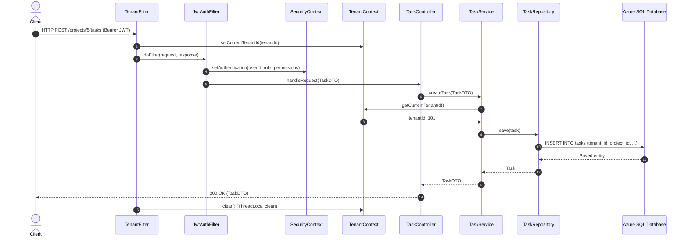
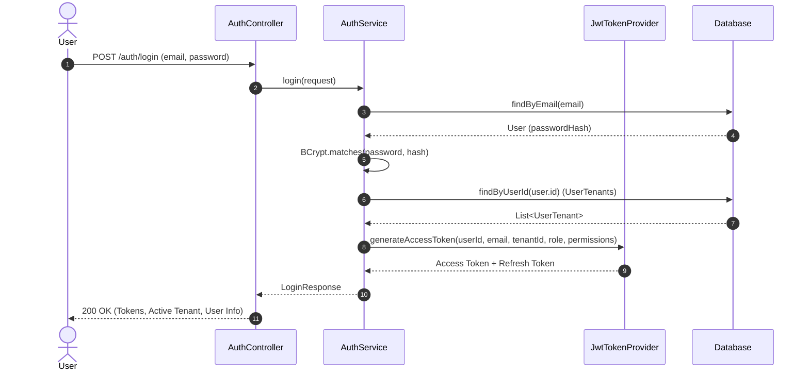

# TeamX Backend Architecture: End-to-End Specification

This document provides a comprehensive, file-by-file, function-by-function architectural blueprint of the TeamX SaaS Platform backend. It details every package, file, class, method, library dependency, third-party integration, and the end-to-end lifecycle of HTTP requests.

---

## Table of Contents
1. [High-Level Architecture & Design Principles](#1-high-level-architecture--design-principles)
2. [Folder & Directory Structure](#2-folder--directory-structure)
3. [Dependencies, Libraries & Third-Party Applications](#3-dependencies-libraries--third-party-applications)
4. [Security, Multi-Tenancy & Request Interception](#4-security-multi-tenancy--request-interception)
5. [Database Layer: Entities & Schema Design](#5-database-layer-entities--schema-design)
6. [Data Access Layer (Repositories)](#6-data-access-layer-repositories)
7. [Business Logic Layer (Services & Functions)](#7-business-logic-layer-services--functions)
8. [API & Controller Layer (REST Endpoints & DTOs)](#8-api--controller-layer-rest-endpoints--dtos)
9. [Exception Handling & Response Flow](#9-exception-handling--response-flow)
10. [End-to-End Request Lifecycles (Step-by-Step Traces)](#10-end-to-end-request-lifecycles-step-by-step-traces)
11. [Architectural Flow Diagrams](#11-architectural-flow-diagrams)

---

## 1. High-Level Architecture & Design Principles

TeamX is built as a **Multi-Tenant B2B SaaS Backend** running on **Java 21** and **Spring Boot 3.4.3**.

```
                           +-----------------------------------------------+
                           |             Next.js 14 Frontend               |
                           +-----------------------------------------------+
                                                  | (HTTPS / JSON / Multipart)
                                                  v
                           +-----------------------------------------------+
                           |          Spring Boot 3.4.3 Backend            |
                           |                                               |
                           |  [CorsFilter] -> [TenantFilter] -> [JwtFilter]|
                           |                                               |
                           |               REST Controllers                |
                           |                      |                        |
                           |               Service Layer (RBAC)            |
                           |                      |                        |
                           |              Spring Data JPA Layer            |
                           +-----------------------------------------------+
                                      /           |           \
                                     /            |            \
                                    v             v             v
             +-----------------------+   +----------------+   +-------------------+
             | Azure SQL Database    |   | SendGrid Email |   | Cloudinary Storage|
             | (Multi-Tenant Row-Lvl)|   | (Invitations)  |   | (File Attachments)|
             +-----------------------+   +----------------+   +-------------------+
```

### Core Design Principles:
1. **Row-Level Multi-Tenant Isolation**: Tenant boundaries are enforced at the thread and database query level via `TenantContext` (`ThreadLocal<Long>`) and `TenantAwareEntity`.
2. **Stateless JWT Security with Role-Based Access Control (RBAC)**: Fine-grained permissions (`PROJECT_READ`, `TASK_WRITE`, `USER_MANAGE`, etc.) are cryptographically signed within JSON Web Tokens (JJWT 0.12.3).
3. **Layered Modular Architecture**: Strict separation of concerns between Controllers (HTTP routing & validation), Services (business logic & security rules), and Repositories (data persistence).
4. **Resilient Third-Party Integrations**: Safe integrations with Cloudinary (with rollback cleanup if DB operations fail) and SendGrid (with graceful offline fallbacks).

---

## 2. Folder & Directory Structure

```
backend/
├── pom.xml                                   # Maven dependencies & build lifecycle
├── Dockerfile                                # Containerized deployment definition
├── .env                                      # Local environment configuration (git-ignored)
└── src/
    ├── main/
    │   ├── java/
    │   │   ├── UpdatePassword.java           # Standalone DB password update utility
    │   │   └── com/saas/platform/
    │   │       ├── SaasPlatformApplication.java # Application entry point & env loader
    │   │       ├── config/                   # Spring beans, security, and data initialization
    │   │       │   ├── BenchmarkDataSeeder.java
    │   │       │   ├── DataInitializer.java
    │   │       │   └── SecurityConfig.java
    │   │       ├── controller/               # REST API Controllers
    │   │       │   ├── AdminController.java
    │   │       │   ├── AuthController.java
    │   │       │   ├── ProjectController.java
    │   │       │   ├── TaskAttachmentController.java
    │   │       │   ├── TaskController.java
    │   │       │   ├── TenantController.java
    │   │       │   └── UserController.java
    │   │       ├── dto/                      # Request & Response Data Transfer Objects
    │   │       │   ├── AcceptInviteRequest.java
    │   │       │   ├── InviteUserRequest.java
    │   │       │   ├── LoginRequest.java
    │   │       │   ├── LoginResponse.java
    │   │       │   ├── ProjectDTO.java
    │   │       │   ├── RegisterRequest.java
    │   │       │   ├── ResetPasswordRequest.java
    │   │       │   ├── TaskAttachmentDTO.java
    │   │       │   ├── TaskDTO.java
    │   │       │   ├── TenantDTO.java
    │   │       │   ├── TenantSwitchRequest.java
    │   │       │   ├── TenantSwitchResponse.java
    │   │       │   ├── UpdateUserRoleRequest.java
    │   │       │   ├── UserManagementDTO.java
    │   │       │   ├── UserTenantAssignmentRequest.java
    │   │       │   └── UserTenantAssignmentResponse.java
    │   │       ├── entity/                   # JPA Database Entities
    │   │       │   ├── InvitationToken.java
    │   │       │   ├── Project.java
    │   │       │   ├── Task.java
    │   │       │   ├── TaskAttachment.java
    │   │       │   ├── Tenant.java
    │   │       │   ├── TenantAwareEntity.java
    │   │       │   ├── User.java
    │   │       │   └── UserTenant.java
    │   │       ├── exception/                # Centralized exception handling
    │   │       │   └── GlobalExceptionHandler.java
    │   │       ├── repository/               # Spring Data JPA interfaces
    │   │       │   ├── InvitationTokenRepository.java
    │   │       │   ├── ProjectRepository.java
    │   │       │   ├── RolePermissionRepository.java
    │   │       │   ├── TaskAttachmentRepository.java
    │   │       │   ├── TaskRepository.java
    │   │       │   ├── TenantRepository.java
    │   │       │   ├── UserRepository.java
    │   │       │   └── UserTenantRepository.java
    │   │       ├── security/                 # Security filters, context, & tokens
    │   │       │   ├── JwtAuthenticationFilter.java
    │   │       │   ├── JwtTokenProvider.java
    │   │       │   ├── RolePermissionMapper.java
    │   │       │   ├── SecurityUtils.java
    │   │       │   ├── TenantContext.java
    │   │       │   └── TenantFilter.java
    │   │       └── service/                  # Business logic services
    │   │           ├── AdminService.java
    │   │           ├── AuthService.java
    │   │           ├── EmailService.java
    │   │           ├── ProjectService.java
    │   │           ├── TaskAttachmentService.java
    │   │           ├── TaskService.java
    │   │           ├── TenantService.java
    │   │           └── UserManagementService.java
    │   └── resources/
    │       ├── application.yml               # Base application configuration
    │       ├── application-dev.yml           # Dev profile overrides
    │       ├── application-prod.yml          # Production Azure SQL overrides
    │       ├── application-benchmark.yml     # Benchmark profile
    │       └── db/migration/
    │           └── V1__baseline_schema.sql   # Flyway baseline database migration
```

---

## 3. Dependencies, Libraries & Third-Party Applications

| Dependency / Library | Maven Artifact | Purpose & Role in Application |
| :--- | :--- | :--- |
| **Spring Boot Starter Web** | `spring-boot-starter-web` | Provides embedded Tomcat, Spring MVC, REST request handling, Jackson JSON serialization. |
| **Spring Boot Data JPA** | `spring-boot-starter-data-jpa` | Provides Hibernate 6, Spring Data repositories, EntityManager, and HikariCP connection pool. |
| **Spring Boot Security** | `spring-boot-starter-security` | Enables Spring Security filter chains, stateless session management, BCrypt password hashing, and `@PreAuthorize` method security. |
| **Spring Boot Validation** | `spring-boot-starter-validation` | Enables Hibernate Validator for DTO validation (`@NotBlank`, `@Email`, `@NotNull`). |
| **Spring Boot Actuator** | `spring-boot-starter-actuator` | Exposes `/actuator/health` and metrics for production observability. |
| **Flyway Core & SQLServer** | `flyway-core`, `flyway-sqlserver` | Executes SQL version migrations (`V1__baseline_schema.sql`) automatically on application startup. |
| **Microsoft SQL Server JDBC** | `mssql-jdbc` | Native JDBC driver for connecting to Azure SQL Database. |
| **Microsoft Entra / MSAL4J** | `msal4j` | Microsoft Authentication Library for Azure AD token resolution if Entra ID authentication is enabled. |
| **H2 Database** | `h2` | Embedded in-memory / local file database for offline local testing and development. |
| **JJWT (Java JWT)** | `jjwt-api`, `jjwt-impl`, `jjwt-jackson` | Generates, signs, and parses HMAC-SHA256 JWT access and refresh tokens. |
| **Cloudinary SDK** | `cloudinary-http44` | Direct integration with Cloudinary for uploading, retrieving, and destroying task attachments and media assets. |
| **SendGrid Java SDK** | `sendgrid-java` | Sends transactional HTML invitation emails to new team members. |
| **Project Lombok** | `lombok` | Code generation for `@Getter`, `@Setter`, `@Builder`, `@RequiredArgsConstructor`, and `@Slf4j`. |
| **MapStruct** | `mapstruct` | High-performance, compile-time object-to-object mapping between entities and DTOs. |
| **Apache Commons Lang** | `commons-lang3` | Utilities for string manipulation, random generation, and sanitization. |

---

## 4. Security, Multi-Tenancy & Request Interception

Security and tenant isolation form the core backbone of every inbound request:

### 1. `TenantContext.java`
- **Role**: Holds the current request's `tenantId` in a `ThreadLocal<Long>` variable.
- **Key Methods**:
  - `setCurrentTenantId(Long tenantId)`: Stores the active tenant ID for the current thread.
  - `getCurrentTenantId()`: Returns the tenant ID, throwing `IllegalStateException` if missing.
  - `getCurrentTenantIdOrNull()`: Safe getter for unauthenticated or non-tenant contexts.
  - `clear()`: Clears the `ThreadLocal` memory in `finally` blocks to prevent thread-pool memory leaks.

### 2. `TenantFilter.java` (Executed 1st in Filter Chain)
- **Role**: Inspects the HTTP `Authorization: Bearer <token>` header, decodes the JWT, extracts `tenant_id`, and sets `TenantContext.setCurrentTenantId(tenantId)`.
- **Cleanup**: In its `finally` block, it guarantees `TenantContext.clear()` is called after the response completes.

### 3. `JwtAuthenticationFilter.java` (Executed 2nd in Filter Chain)
- **Role**: Validates the JWT signature and expiration.
- **Context Injection**: Extracts `userId`, `role`, and `permissions` (e.g. `PROJECT_READ`, `TASK_WRITE`), creates a `UsernamePasswordAuthenticationToken`, and loads it into `SecurityContextHolder.getContext().setAuthentication(...)`.

### 4. `JwtTokenProvider.java`
- **Role**: Handles cryptographic JWT operations.
- **Key Methods**:
  - `generateAccessToken(...)`: Signs JWT with HMAC-SHA key, embedding `userId`, `email`, `tenant_id`, `tenant_name`, `role`, and `permissions`.
  - `generateRefreshToken(Long userId)`: Generates long-lived refresh token.
  - `validateToken(String token)`: Validates JWT signature and expiration.
  - `getTenantIdFromToken(String token)`, `getUserIdFromToken(String token)`, `getPermissionsFromToken(String token)`, `getRoleFromToken(String token)`.

### 5. `RolePermissionMapper.java`
- **Role**: Maps static user roles (`OWNER`, `ORG_ADMIN`, `MANAGER`, `USER`) to granular permissions.
  - `OWNER / ORG_ADMIN`: `PROJECT_READ`, `PROJECT_WRITE`, `TASK_READ`, `TASK_WRITE`, `TASK_ASSIGN`, `USER_MANAGE`, `TENANT_SETTINGS`.
  - `MANAGER`: `PROJECT_READ`, `PROJECT_WRITE`, `TASK_READ`, `TASK_WRITE`, `TASK_ASSIGN`.
  - `USER`: `PROJECT_READ`, `TASK_READ`, `TASK_WRITE` (own tasks).

### 6. `SecurityConfig.java`
- **Role**: Configures CORS (`allowed-origins`), disables CSRF (stateless API), declares public routes (`/auth/**`, `/h2-console/**`), and registers `TenantFilter` and `JwtAuthenticationFilter`.

---

## 5. Database Layer: Entities & Schema Design

### Entity Class Hierarchy & Model Details

```
TenantAwareEntity (Abstract MappedSuperclass)
├── Project
├── Task
└── TaskAttachment
```

1. **`TenantAwareEntity.java`**:
   - Fields: `tenantId` (`BIGINT`), `createdAt` (`Instant`), `updatedAt` (`Instant`).
   - Annotations: `@MappedSuperclass`, `@EntityListeners(AuditingEntityListener.class)`.
   - `@PrePersist prePersist()`: Automatically injects `TenantContext.getCurrentTenantId()` if not manually set.
   - `@PostLoad postLoad()`: Validates that loaded records match the active `TenantContext.getCurrentTenantId()`, preventing cross-tenant leakage.

2. **`Tenant.java`** (Table: `tenants`):
   - Fields: `id`, `name`, `subdomain` (unique), `status` (`ACTIVE`, `SUSPENDED`), `settings` (`NVARCHAR(MAX)`), `createdAt`, `updatedAt`.

3. **`User.java`** (Table: `users`):
   - Fields: `id`, `email` (unique), `passwordHash` (BCrypt), `firstName`, `lastName`, `status` (`ACTIVE`, `INACTIVE`, `PENDING`), `lastLogin`, `passwordResetRequired`, `createdAt`, `updatedAt`.

4. **`UserTenant.java`** (Table: `user_tenants`):
   - Composite relation linking users to organizations with distinct roles.
   - Fields: `id`, `userId`, `tenantId`, `role` (`OWNER`, `ORG_ADMIN`, `MANAGER`, `USER`), `status` (`ACTIVE`, `PENDING`), `joinedAt`.

5. **`Project.java`** (Table: `projects`):
   - Fields: `id`, `tenantId`, `name`, `description`, `ownerId`, `status` (`ACTIVE`, `ARCHIVED`, `COMPLETED`), `createdBy`.

6. **`Task.java`** (Table: `tasks`):
   - Fields: `id`, `tenantId`, `projectId`, `title`, `description`, `assignedTo`, `status` (`TODO`, `IN_PROGRESS`, `DONE`), `priority` (`LOW`, `MEDIUM`, `HIGH`, `URGENT`), `dueDate`, `createdBy`.

7. **`TaskAttachment.java`** (Table: `task_attachments`):
   - Fields: `id`, `tenantId`, `taskId`, `originalFilename`, `storedFilename`, `contentType`, `fileSize`, `cloudinaryPublicId`, `cloudinarySecureUrl`, `uploadedBy`, `resourceType`.

8. **`InvitationToken.java`** (Table: `invitation_tokens`):
   - Fields: `id`, `token` (UUID), `email`, `tenantId`, `role`, `expiresAt`, `createdAt`.

---

## 6. Data Access Layer (Repositories)

All repositories extend Spring Data's `JpaRepository` and define tenant-scoped queries:

| Repository | Key Methods & Queries |
| :--- | :--- |
| **`TenantRepository`** | `existsBySubdomain(String subdomain)` |
| **`UserRepository`** | `findByEmail(String email)`, `existsByEmail(String email)` |
| **`UserTenantRepository`** | `findByUserId(Long userId)`, `findByTenantId(Long tenantId)`, `findByUserIdAndTenantId(Long userId, Long tenantId)` |
| **`ProjectRepository`** | `findAllByTenantId(Long tenantId)`, `findByIdAndTenantId(Long id, Long tenantId)` |
| **`TaskRepository`** | `findAllByTenantIdAndProjectId(Long tenantId, Long projectId)`, `findByIdAndTenantIdAndProjectId(Long id, Long tenantId, Long projectId)` |
| **`TaskAttachmentRepository`** | `findAllByTenantIdAndTaskIdOrderByCreatedAtDesc(Long tenantId, Long taskId)`, `findByIdAndTenantIdAndTaskId(Long id, Long tenantId, Long taskId)` |
| **`InvitationTokenRepository`** | `findByToken(String token)`, `deleteByEmailAndTenantId(String email, Long tenantId)` |
| **`RolePermissionRepository`** | `findPermissionsByRole(UserTenant.Role role)` |

---

## 7. Business Logic Layer (Services & Functions)

### 1. `AuthService.java`
- `register(RegisterRequest)`:
  1. Validates and normalizes email.
  2. Creates new `Tenant` with unique subdomain.
  3. Hashes password using `BCryptPasswordEncoder(12)`.
  4. Creates new `User` with `ACTIVE` status.
  5. Links user to tenant with `OWNER` role.
  6. Generates and returns JWT access and refresh tokens.
- `login(LoginRequest)`:
  1. Authenticates email and BCrypt password hash.
  2. Resolves user tenant memberships.
  3. If user belongs to multiple tenants and none is selected, flags `requiresTenantSelection: true`.
  4. Signs access token with tenant context, role, and permissions.
- `switchTenant(TenantSwitchRequest)`:
  1. Validates that the user has an active membership in target tenant.
  2. Issues a new access token bound to the selected tenant ID and role permissions.
- `refreshAccessToken(refreshToken, tenantId)`:
  1. Validates refresh token signature.
  2. Generates new access and refresh token pair.
- `acceptInvite(AcceptInviteRequest)`:
  1. Validates invitation token and expiry.
  2. Activates pending user account and sets new password.
  3. Activates `UserTenant` relation and deletes used invitation token.

### 2. `ProjectService.java`
- `getAllProjects()`: Lists all projects belonging to the active `tenantId`.
- `getProjectById(Long id)`: Finds a project by ID and validates tenant ownership.
- `createProject(ProjectDTO)`: Creates a new project with current user as owner and attaches `TenantContext.getCurrentTenantId()`.

### 3. `TaskService.java`
- `getTasksByProject(Long projectId)`: Fetches tasks for a specific project within the tenant.
- `createTask(TaskDTO)`:
  - Enforces role rules: `USER` (Employee) cannot create or assign tasks.
  - Enforces assignment rules: `MANAGER` can only assign to `USER`s.
- `updateTask(Long projectId, Long taskId, TaskDTO)`:
  - `USER` role is restricted to updating task completion status only.
  - `ORG_ADMIN` / `MANAGER` can update all fields and reassign tasks.

### 4. `TaskAttachmentService.java`
- `uploadAttachment(projectId, taskId, MultipartFile)`:
  1. Asserts task exists and belongs to active tenant.
  2. Inspects byte headers (`magic bytes`) for PDF, JPEG, PNG, GIF, WebP (prevents malicious file extensions).
  3. Uploads file to Cloudinary under folder `teamx/tickets`.
  4. Saves `TaskAttachment` in database.
  5. **Compensating Rollback**: If database save throws an error, immediately deletes the uploaded asset from Cloudinary to prevent orphan storage costs.
- `deleteAttachment(projectId, taskId, attachmentId)`:
  1. Deletes record from DB.
  2. Calls Cloudinary API to destroy the remote asset.

### 5. `UserManagementService.java`
- `listUsers()`: Lists all members of the active tenant.
- `inviteUser(InviteUserRequest)`:
  1. Creates user in `PENDING` status if new.
  2. Generates 7-day cryptographically secure `InvitationToken`.
  3. Dispatches HTML invitation email via `EmailService`.
- `updateUserRole(Long userId, UpdateUserRoleRequest)`:
  - Prevents modifying or assigning the `OWNER` role.
  - Prevents demoting the last active `ORG_ADMIN`.
- `deleteUser(Long userId)`:
  - Prevents deleting own account, `OWNER`, or last active `ORG_ADMIN`.
  - Removes user from tenant and purges pending invitations.

### 6. `EmailService.java`
- `sendInvitationEmail(toEmail, token, tenantName, inviterName)`:
  - Builds transactional HTML email with dynamic join link.
  - Sends request to SendGrid API (`mail/send`).
  - Fallback: Logs link locally if `SENDGRID_API_KEY` is not configured.

---

## 8. API & Controller Layer (REST Endpoints & DTOs)

All controllers use base path `/api/v1` (configured via `server.servlet.context-path`).

```
+-----------------------------------------------------------------------------------------+
| Controller                   | Method | Endpoint                             | Auth Req |
+-----------------------------------------------------------------------------------------+
| AuthController               | POST   | /api/v1/auth/register                | No       |
| AuthController               | POST   | /api/v1/auth/login                   | No       |
| AuthController               | POST   | /api/v1/auth/refresh                 | No       |
| AuthController               | POST   | /api/v1/auth/switch-tenant           | Yes      |
| AuthController               | POST   | /api/v1/auth/reset-password          | No       |
| AuthController               | POST   | /api/v1/auth/accept-invite           | No       |
| TenantController             | GET    | /api/v1/tenant                       | Yes      |
| UserController               | GET    | /api/v1/users                        | Yes      |
| UserController               | POST   | /api/v1/users/invite                 | Yes      |
| UserController               | PUT    | /api/v1/users/{userId}/role          | Yes      |
| UserController               | DELETE | /api/v1/users/{userId}               | Yes      |
| ProjectController            | GET    | /api/v1/projects                     | Yes      |
| ProjectController            | GET    | /api/v1/projects/{id}                | Yes      |
| ProjectController            | POST   | /api/v1/projects                     | Yes      |
| TaskController               | GET    | /api/v1/projects/{pId}/tasks         | Yes      |
| TaskController               | POST   | /api/v1/projects/{pId}/tasks         | Yes      |
| TaskController               | PUT    | /api/v1/projects/{pId}/tasks/{tId}   | Yes      |
| TaskAttachmentController     | GET    | /api/v1/projects/{pId}/tasks/{tId}/..| Yes      |
| TaskAttachmentController     | POST   | /api/v1/projects/{pId}/tasks/{tId}/..| Yes      |
| TaskAttachmentController     | DELETE | /api/v1/projects/{pId}/tasks/{tId}/..| Yes      |
| AdminController              | GET    | /api/v1/admin/users                  | Yes      |
| AdminController              | POST   | /api/v1/admin/users                  | Yes      |
| AdminController              | DELETE | /api/v1/admin/users/{userId}         | Yes      |
+-----------------------------------------------------------------------------------------+
```

---

## 9. Exception Handling & Response Flow

All errors are intercepted centrally by [`GlobalExceptionHandler.java`](file:///d:/My%20projects/TeamX/backend/src/main/java/com/saas/platform/exception/GlobalExceptionHandler.java) (`@RestControllerAdvice`):

### Unified Error Structure:
```json
{
  "status": 400,
  "error": "BAD_REQUEST",
  "message": "Validation failed for input fields",
  "timestamp": "2026-08-31T18:30:00Z",
  "details": {
    "email": "Email must be a valid email address",
    "password": "Password must be at least 8 characters"
  }
}
```

- **`ResponseStatusException`**: Handled with matching HTTP status codes and custom reason messages.
- **`MethodArgumentNotValidException`**: Intercepts `@Valid` annotation failures on request DTOs and extracts field-level error messages.
- **Generic `Exception`**: Catches unhandled runtime errors, logs the stack trace securely, and returns a safe HTTP 500 JSON response.

---

## 10. End-to-End Request Lifecycles (Step-by-Step Traces)

### Scenario A: Creating a New Task with Multi-Tenancy & Validation

```
[Client Request: POST /api/v1/projects/5/tasks]
       |  Header: Authorization: Bearer <JWT>
       v
1. SecurityFilterChain -> TenantFilter
       |  - Parses JWT
       |  - Extracts claim "tenant_id" = 101
       |  - Calls TenantContext.setCurrentTenantId(101)
       v
2. SecurityFilterChain -> JwtAuthenticationFilter
       |  - Validates cryptographic signature using HMAC-SHA key
       |  - Extracts "userId" = 42, "role" = "MANAGER", "permissions" = ["TASK_WRITE", ...]
       |  - Populates SecurityContextHolder with Authentication token
       v
3. TaskController.createTask(projectId=5, TaskDTO)
       |  - Validates DTO annotations (@Valid)
       |  - Delegates to TaskService.createTask(dto)
       v
4. TaskService.createTask()
       |  - Checks @PreAuthorize("hasAuthority('TASK_WRITE')") -> PASS
       |  - Retrieves current user ID (42) and current tenant ID (101)
       |  - Validates assignment rules (Manager assigning to Employee -> PASS)
       |  - Builds Task entity
       |  - Calls taskRepository.save(task)
       v
5. JPA Layer & TenantAwareEntity Lifecycle
       |  - @PrePersist executes: sets task.tenantId = 101
       |  - AuditingEntityListener sets task.createdAt = Instant.now()
       |  - Hibernate sends SQL: INSERT INTO tasks (tenant_id, project_id, title, ...)
       v
6. Controller transforms Task entity to TaskDTO and returns HTTP 201 CREATED.
       v
7. TenantFilter finally block executes:
       |  - Calls TenantContext.clear() (cleans up ThreadLocal)
```

---

### Scenario B: Uploading a File Attachment to Cloudinary

```
[Client Request: POST /api/v1/projects/5/tasks/12/attachments (Multipart)]
       |
1. TenantFilter & JwtAuthenticationFilter authenticate request.
       v
2. TaskAttachmentController.uploadAttachment(file) delegates to TaskAttachmentService.
       v
3. TaskAttachmentService:
       |  - Validates task 12 belongs to project 5 and tenant 101.
       |  - Reads file header magic bytes (e.g. %PDF or \xFF\xD8\xFF) -> Confirms valid file.
       |  - Calls Cloudinary SDK: cloudinary.uploader().upload(...) -> Uploads to Cloud CDN.
       |  - Cloudinary returns: secure_url, public_id, bytes, format.
       |  - Saves TaskAttachment record in Azure SQL with secure CDN URL.
       |  - (If SQL fails: automatically calls Cloudinary.destroy() to compensate).
       v
4. Returns TaskAttachmentDTO with secure Cloudinary URL.
```

---

## 11. Architectural Flow Diagrams

### Multi-Tenant Request Isolation Flow



---

### Authentication & Tenant Switch Flow



---

## Summary

The TeamX backend architecture provides a secure, hardened, enterprise-grade multi-tenant foundation:
- **Zero Tenant Leaks**: Dual-level enforcement (Filter + JPA `@PrePersist` / `@PostLoad`).
- **High Performance**: Connection pooling via HikariCP, compile-time DTO generation via MapStruct, and stateless JWT tokens.
- **Cloud Scale**: Decoupled cloud assets (Cloudinary) and transactional email routing (SendGrid).
